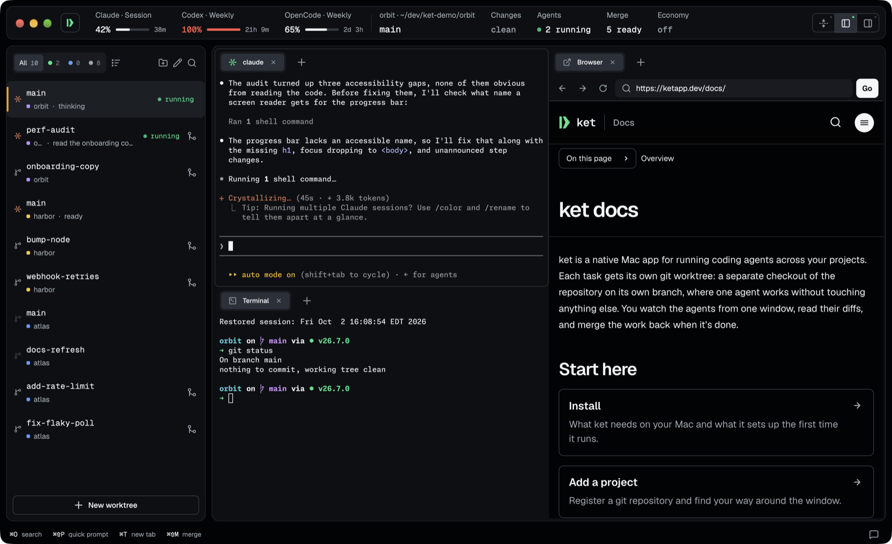
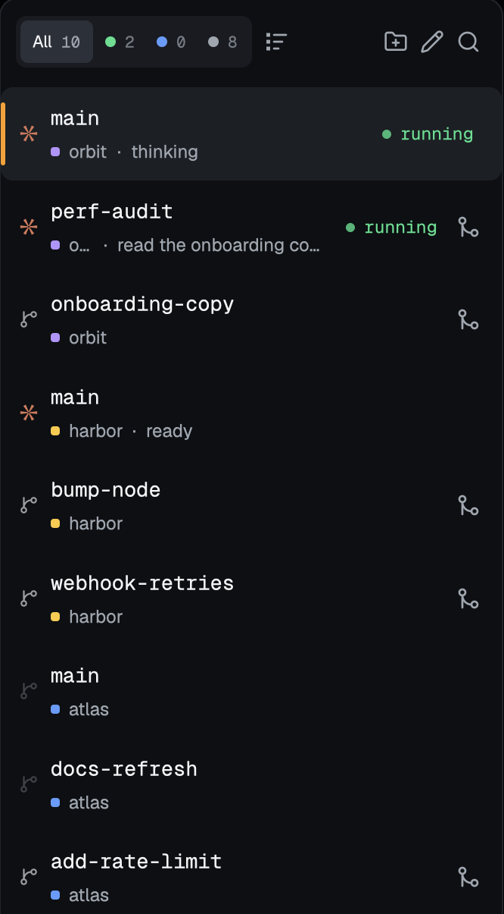
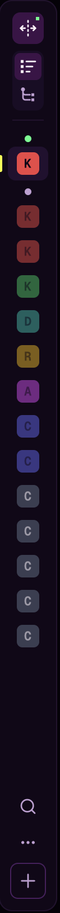
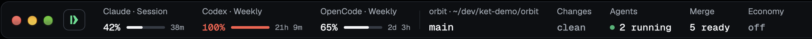
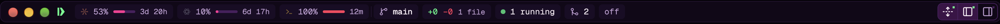
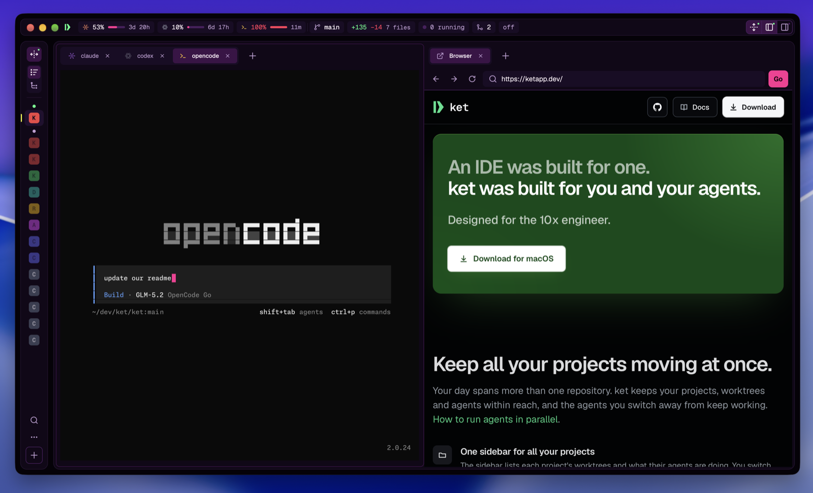

<p align="center">
  
</p>

<h1 align="center">ket</h1>

<p align="center">
  <strong>Build across projects at agent speed.</strong><br>
  Work across many projects with multiple agents and isolated worktrees—all in
  one focused native workspace.
</p>

<p align="center">
  <a href="https://ketapp.dev">ketapp.dev</a> ·
  <a href="https://ketapp.dev/docs/">Docs</a> ·
  <a href="https://ketapp.dev/cli/">CLI reference</a> ·
  <a href="CONTRIBUTING.md">Contributing</a>
</p>

<p align="center">
  <sub>ket is in beta. Expect rough edges, and
  <a href="https://github.com/ketapp/ket/issues">tell us what breaks</a>.</sub>
</p>

<p align="center">
  
</p>

An IDE was built for one. ket was built for you and your agents.

Each task gets its own Git worktree: a separate checkout of the repository on
its own branch, where one agent works without touching anything else. You
watch the agents from one window, read their diffs, and merge the work back
when it's done.

> ket isn't released yet. Until the first public build, run it from source —
> see [Build and run](#build-and-run).

## Keep all your projects moving at once

Your day spans more than one repository. ket keeps your projects, worktrees
and agents within reach, and the agents you switch away from keep working.

<table>
  <tr>
    <td width="300" valign="top"></td>
    <td width="70" valign="top"></td>
    <td valign="top">
      <p><strong>One sidebar for all your projects.</strong> The sidebar lists
      each project's worktrees and what their agents are doing. You switch
      codebases with one click, and fold it to a rail of project badges when
      you want the room.</p>
      <p><strong>Know when an agent needs you.</strong> An agent that stops
      for you in another project tells you at once, so you can answer it
      without checking each project.</p>
      <p><strong>Prompt any project from anywhere.</strong> Type into the
      quick prompt to send work to any project, in an existing worktree or a
      new one, without leaving the one you're in.</p>
    </td>
  </tr>
</table>

## Spend less on the same work

Economy tells a worktree's agent how much to say, from Off to Max, in Claude
Code and Codex. Fewer recaps and less restating means fewer tokens, and ket
estimates what every session cost and what it saved. Plan usage, running
agents, work waiting to merge and the Economy level sit in the header, which
folds to a single line.




## Everything around the agent

- **Run it from your iPhone or iPad.** Pair with a QR code, then follow every
  run, answer permission prompts, start a task, and review and merge its diff.
  The phone reaches your Mac over your own Wi-Fi, encrypted end to end.
- **Your app's screen, in a tab.** Open the iPhone Simulator or the Android
  Emulator as a tab beside the agent building your app, and <kbd>⌘S</kbd>
  sends it a screenshot. The iPhone Simulator needs Apple silicon and Xcode.
- **Speak your prompt.** Dictate instead of typing. On Apple silicon, ket
  transcribes common languages on the device, so the audio stays on your Mac.
- **A backlog for every project.** Write a task down in one line and come back
  to it. A note can carry a description and files, and Start in worktree makes
  a worktree for it and hands the agent the whole note.
- **Merge from the sidebar, or open a pull request.** ket lists what it will
  commit, then commits the work and merges the branch into its base in your
  primary checkout. It never switches that checkout's branch for you. Or push
  instead: ket pushes the branch as the project's GitHub account and opens
  the pull request with a title and description you checked first.
- **A second opinion from Jev.** In beta, with a TypeSafe API key: Jev picks
  the Economy level for tasks started from your phone, the backlog or the quick
  prompt, and rates each permission prompt low, medium or high on your phone.
  It never answers one for you.

## Bring your own agents

ket works with any coding agent, on any model. You choose the agent for each
worktree, and the model through that agent or a local model through Ollama.
ket finds Claude Code, Codex, Grok and OpenCode on its own and shows what each
one is doing. Missing yours? ket is open source, so you can add it with a pull
request.



## Script any of it

The `ket` command talks to the same engine as the app, so you can add
projects, create worktrees, start agents and read diffs from a shell or a
script.

```console
$ ket project add .
$ ket worktree add fix-flaky-poll
fix-flaky-poll-3f2a9c41d0be
$ ket run claude -o fix-flaky-poll-3f2a9c41d0be -p "fix the flaky test"
$ ket ps
$ ket diff fix-flaky-poll-3f2a9c41d0be --stat
$ ket events --follow
```

## Built in Rust, from the ground up

ket is Rust end to end. It draws its interface on the GPU with no browser
underneath, and keeps disk work off the UI thread so the window responds while
your agents run.

- **Rust.** The app, the engine and the CLI share one language.
- **GPU.** [gpui](https://www.gpui.rs) draws every frame through Metal, and
  terminals run on `alacritty_terminal`.
- **No Electron.** No bundled browser or JavaScript runtime. Optional browser
  tabs use the system's WKWebView.
- **293 ms** to clone a 20,000-file dependency folder copy-on-write.

> ket launches tools that can execute commands as your user. Only enable
> repository automation after you trust the repository. Worktrees isolate Git
> changes; they are not security sandboxes.

## Supported platforms

The desktop application and release bundle target macOS 11 or newer. Core and
CLI code may compile elsewhere, but non-macOS desktop behavior is not a
supported release target yet. The companion phone app is built with Expo and
reaches the Mac over the local network; see `mobile/app/README.md`.

## Workspace layout

| Path | Role |
|---|---|
| `crates/ket-core` | Projects, worktrees, agents, persistence, terminal host, and policy |
| `crates/ket-cli` | The `ket` command-line client |
| `crates/ket-ui` | Native GPUI desktop application |
| `crates/ket-remote` | Noise session and phone application protocol |
| `crates/ket-relay-protocol` | Bounded relay framing |
| `crates/ket-relay` | Local/development WebSocket relay |
| `crates/ket-android` | Android-facing Rust integration |
| `crates/ket-feedback` | Receives in-app feedback reports and emails them to one address |
| `mobile/remote` | TypeScript remote-protocol client |
| `mobile/app` | Expo phone application |
| `vendor` | Locally patched GPUI and Alacritty terminal crates |

## Build and run

Install Xcode, Git, Node.js 22 or newer, and Rust. The full Xcode app is
needed, not only its command-line tools: GPUI compiles its Metal shaders with
`xcrun metal` (on Xcode 26, also install the Metal toolchain from Xcode's
Components settings). The pinned Rust toolchain installs automatically from
`rust-toolchain.toml`.

```sh
cargo check --workspace
cargo build -p ket-cli
cargo build -p ket-ui
```

For development, keep ket away from your normal application state:

```sh
export XDG_DATA_HOME="$(mktemp -d)"
cargo run -p ket-cli -- project add .
cargo run -p ket-ui
```

Creating a worktree still changes the source repository's `.git/worktrees`
registry. Remove development worktrees explicitly when finished.

Logging is controlled by `KET_LOG`, using tracing-subscriber's filter syntax:

```sh
KET_LOG=debug cargo run -p ket-cli -- doctor
KET_LOG=ket_core::event=trace cargo run -p ket-cli -- events --follow
```

## Phone development

```sh
npm ci --prefix mobile/remote
npm ci --prefix mobile/app
npm run typecheck --prefix mobile/remote
npm run typecheck --prefix mobile/app
npm run start --prefix mobile/app
```

See `mobile/app/README.md` for device and native-build instructions.

## Protocol generation

`crates/ket-remote/proto/ket/remote/v1/remote.proto` is the canonical phone
application contract. Rust bindings are generated during the crate build.
Regenerate and commit TypeScript bindings after every schema change:

```sh
npm ci --prefix mobile/remote
npm run generate --prefix mobile/remote
git diff --exit-code -- mobile/remote/src/gen
```

The local desktop-host wire protocol is separate and currently version 5. The
phone application protocol is version 1.10. Compatibility-sensitive changes
must preserve live-host attachment or include an explicit migration plan.

## Quality checks

```sh
cargo fmt --all --check
cargo check --workspace
cargo clippy --workspace --all-targets -- -D warnings
cargo test --workspace

npm run typecheck --prefix mobile/remote
npm test --prefix mobile/remote
npm run typecheck --prefix mobile/app
npm run lint --prefix mobile/app
npm test --prefix mobile/app -- --runInBand
```

CI also checks generated protocol drift. The scheduled dependency workflow runs
Rust advisory and license checks, and npm audits with a reviewed allowlist in
`.github/npm-audit-allow.json` for advisories that have no patched release.

## Release process

1. Update versions and user-facing release notes.
2. Run all quality, protocol-drift, advisory, and license checks.
3. Build the application with `scripts/bundle-macos.sh`.
4. Test the bundle using disposable ket state and a disposable repository.
5. For distribution to another Mac, replace the script's ad-hoc signature with
   Developer ID signing and Apple notarization.
6. Publish the matching source revision, lockfiles, `LICENSE`, and `NOTICE.md`.

The repository does not currently automate signing, notarization, or publishing.

## Security

Pairing requires desktop confirmation and grants an explicit Viewer,
Controller, Operator, or Administrator role. Phone traffic is encrypted with
Noise and pins the host key. Local IPC uses owner-only paths and validates
privileged peers. Network frames, handshake concurrency, untracked review
reads, and expensive phone operations are bounded.

Agents still run with the current user's authority, and trusted project hooks
and post-provision commands are code execution. See `SECURITY.md` for private
reporting.

### Outside ket's own data directory

To show what each agent is doing, ket installs hooks into the agents' own
configuration when it starts:

- Claude Code: hook commands in `~/.claude/settings.json`, and a status line
  that runs any status line you already had after its own.
- Codex: hook commands in `~/.codex/hooks.json`.
- OpenCode: a plugin in `~/.config/opencode/plugin/`.
- Grok: a hooks file at `~/.grok/hooks/ket.json`.

These hooks run in every session of those agents, including ones ket did not
start. A report that cannot reach a running ket is kept in the owner-only file
`~/.ket/agent-hooks/spool.jsonl` until ket next starts. Settings → General →
**Remove ket from your agents** takes all of them out again.

To show Claude usage limits, ket reads Claude Code's sign-in from the macOS
Keychain (or `.credentials.json` in Claude Code's config directory) and sends
it only to Anthropic's usage endpoint. It does not read any other agent's
credentials.

## Contributing and licensing

Contributions are welcome; start with `CONTRIBUTING.md` and follow
`CODE_OF_CONDUCT.md`. ket is available under the MIT license. Bundled third-
party code, fonts, icons, and generated assets are listed in `NOTICE.md`.
